# Title: TreePrint

## Student Information
•	Name: Barka Kalongwe  
•	Student Number: ST10527777  
•	Module / Course: Web Development (Introduction)  
•	Submission: Part 3

## Repository link
https://github.com/EMGPSD/wede5020-2026-part-3-bkal835

## Project Overview

TreePrint is a website built to encourage and support tree planting as a way of tackling environmental degradation and promoting sustainability. The site gives visitors a simple way to learn about the initiative, donate towards tree planting efforts, plant a tree themselves, and track planted trees on an interactive map. It also provides information about the team history and vision and clear channels for visitors to get in touch or make enquiries.
This README documents Part 1 and Part 2 of the project. Part 3 will be added in future submissions.

## Website Goals and Objectives

The Treeprint website aims to:  
•	Record and display tree planting locations using an interactive map.  
•	Highlight regions where there is little or no tree coverage.  
•	Encourage donations to support tree-planting projects.  
•	Track yearly tree-planting goals and display progress.  
•	Educate visitors about environmental conservation.  
•	Increase community participation in reforestation projects. 

## Key Features and Functionality (Part 1)

### Home Page
•	Introduction to Treeprint
•	Annual tree goal progress
•	Featured statistics
•	Call-to-action buttons
### About Us
•	Organisation history
•	Mission and vision
•	Environmental impact
### Interactive Tree Map
•	View planted trees
•	Search locations
•	Filter by region
•	Heat map showing areas needing more trees
### Plant a Tree
•	Submit new tree planting records
•	Upload photos
•	Verification process
### Donate
•	Secure online donations
•	Donation amount selection
•	Project sponsorship
### Enquiry
•	Form to fill
•	Enquire about being a volunteer or sponsor
### Contact Us
•	Contact form
•	Email
•	Phone number
•	Social media links

## Key Features and Functionality (Part 2)
 
Part 2 adds the CSS styling and the responsive web design (RWD). Every page links to the same external stylesheet: assets/styles/style.css.
 
### Colour palette
| Colour | Hex code | Purpose |  
|--------|----------|---------|  
| Forest Green | #2E7D32 | Primary branding colour (headings, banner, footer) |  
| Light Green | #81C784 | Highlights and buttons (cards, borders, buttons) |  
| Earth Brown | #795548 | Supporting accents (subheadings, footer top border) |  
| Sky Blue | #64B5F6 | Interactive elements and links (links, hover and focus states) |  
| White | #FFFFFF | Background |  
| Dark Grey | #424242 | Text |
 
### Typography
- Headings: Poppins Bold
- Subheadings: Poppins SemiBold
- Body text: Open Sans Regular (Open Sans Bold is used for buttons)
- The fonts are loaded from the assets/fonts folder with @font-face.

### Styling
- Navigation bar: logo on the left and page links on the right (flexbox). Links change colour on hover and the logo grows when the mouse is over it.
- Banners: green banner with text on one side and an image on the other (Home, About Us and Donate).
- Cards: each section and form is a white card with a rounded Light Green border.
- Home Page: the annual goal and the featured statistics sit side by side in a two-column grid.
- About Us: the headings sit at the top of their sections, with an icon next to the text. The "Our Impact So Far" figures are shown in four green boxes with an icon, a large number and a label.
- Tree Map: "Search for a Location" and "Region Filter" are shown in two columns.
- Donate: the R50, R100 and R500 amounts are buttons, and a custom amount field with a "Donate" button was added.
- Forms (Plant a Tree and Enquiry): styled inputs with a Sky Blue outline when selected, and rounded buttons that change colour on hover.
- Footer: four columns with headings (Treeprint, Quick Links, Get Involved, Contact Us and Follow Us). "Plant a Tree", "Volunteer" and "Become a Sponsor" are links.

### Responsive web design
- Every page has the viewport meta tag so it scales correctly on mobile devices.
- Layouts are built with flexbox and CSS grid, and the main content has a maximum width so it stays readable on large screens.
- Two breakpoints are set with media queries:

| Screen | Breakpoint | What changes |
|--------|------------|--------------|
|Desktop|wider than 900px|Full layout: cards side by side, four impact boxes in a row, four footer columns|
|Tablet|900px and below|Home page cards stack one under the other, impact boxes and footer go to two columns, banner spacing is reduced|
|Phone|600px and below|Everything goes to one column: navigation is stacked and centred, banner text sits above/below the image, donation amounts stack, form labels move above their inputs, and headings are smaller|

## Update: Feedback on Part 2

The feedback received for Task 2 (Part 2):

> **Areas That Need Attention**
>
> Before Part 3, consider expanding responsive typography adaptations to improve readability on smaller devices. Additional navigation refinements on mobile and broader usage of pseudo-classes would strengthen the user experience. Continue testing page layouts at multiple viewport widths to ensure consistency.

### How the feedback was dealt with

| Feedback | What the website does now | What can still be improved |
|----------|---------------------------|----------------------------|
| Expand responsive typography on smaller devices | At 600px and below the main headings are smaller (`h1` 1.8rem, banner heading 2.2rem and 1.8rem inside `main`), padding is reduced so the text has more room. Form labels move above their inputs so the text is not squeezed beside them. | Body text, card text and button text keep the same size on phones. Reducing them is the next step. |
| Navigation refinements on mobile | At 600px and below the navigation bar stacks (logo on top) and the links are centred and wrap onto more lines instead of overflowing. On every inner page the link of the page you are on is highlighted in the navigation bar (the `active` link with `aria-current="page"`), and an Events link was added. | The links are stacked, not a collapsed "hamburger" menu. A toggle menu would save space on phones. |
| Broader usage of pseudo-classes | `:hover` is used on the logo, navigation links, buttons, banner links and headings, footer links and the location drop-down. `:focus` is used on inputs, the text area and the enquiry select. `:first-child` is used on the home page statistics. | There still is area for more pseudo-classes. |
| Test the layouts at multiple viewport widths | Every page was tested at 1280px (desktop), 768px (tablet) and 390px (phone). No page scrolls sideways at any of these widths. The screenshots are in the *Responsive Design* section below. | Testing at in-between widths (for example 600 to 700px and 900 to 1000px) can be added. |

## Key Features and Functionality (Part 3)

Part 3 adds the JavaScript interactivity, the final responsive design checks and the SEO. The JavaScript is in the `js` folder:

| File | Used on | What it does |
|------|---------|--------------|
| `js/script.js` | Enquiry, Plant a Tree, Donate | Form validation, feedback messages, the upload button and the donation buttons |
| `js/locations.js` | Tree Map | Location search and region filter |
| `js/heatmap.js` | Tree Map | Heat map of tree coverage (uses `js/leaflet.js`) |
| `js/lightbox3.min.js` | Events | Pop-up photo gallery (Lightbox3 library) |

### What changed since Part 2
- Tree Map: the search and the region filter now each sit in their own card (the dividing line from Part 2 was removed), and the page has location cards, a Map Legend and the heat map.
- Banners were added to the Tree Map and Events pages (Part 2 had them on Home, About Us and Donate).
- New page: `events.html` (volunteer activities with a photo gallery).
- New files: `404.html`, `robots.txt` and `sitemap.xml`.
- Every page now has an SEO title, description, keywords, canonical link and Open Graph tags.
- Forms and buttons now work with JavaScript instead of only HTML.

### JavaScript Features
#### 1. Enquiry form validation and feedback (`js/script.js`, Enquiry page)

**Screenshot**

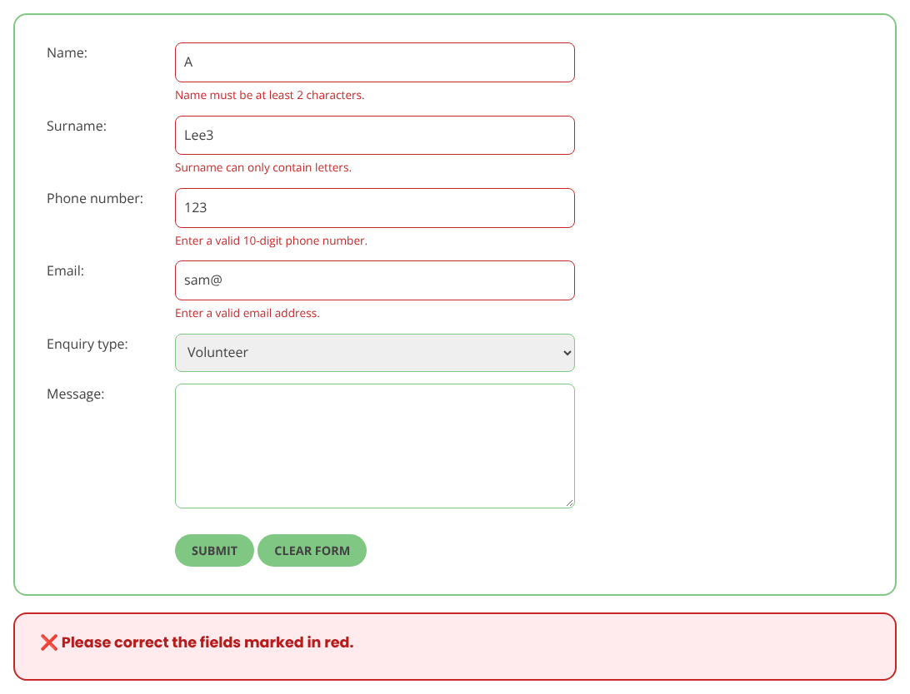

*Mistakes are shown in red under each field when the form is sent.*

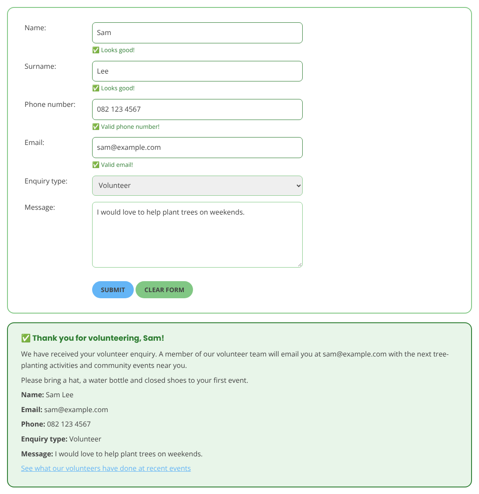
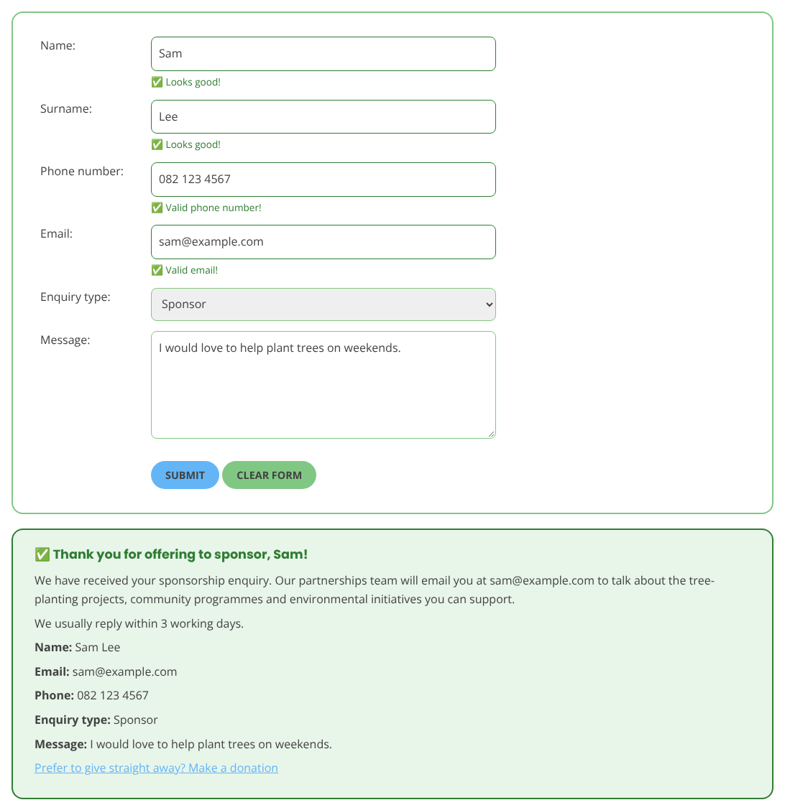

*A correct form shows a different message for a volunteer and for a sponsor.*

**Code snippet**
```js
function isValidEmail(value) {
  return /^[^\s@]+@[^\s@]+\.[^\s@]+$/.test(value);
}

function isValidPhone(value) {
  return /^\d{10}$/.test(value.replace(/[\s\-()]/g, ''));
}

// Submit: every check runs, so all the mistakes show at the same time
enquiryForm.addEventListener('submit', function(e) {
  e.preventDefault();
  const results = [
    checkName(nameInput, nameError, 'Name'),
    checkName(surnameInput, surnameError, 'Surname'),
    checkPhone(),
    checkEmail(emailInput, emailError)
  ];
  if (results.indexOf(false) !== -1) {
    showResult(enquiryResult, 'error', '❌ Please correct the fields marked in red.', [], []);
    return;
  }
  // A different feedback message for volunteers and sponsors
  if (type === 'volunteer') { /* thank-you for volunteering */ }
  else { /* thank-you for offering to sponsor */ }
});
```

**Business purpose**
Treeprint depends on volunteers and sponsors. Checking the details before they are sent means the team receives usable contact details and fewer incomplete enquiries. The personal thank-you message, different for volunteers and sponsors, shows what happens next and makes the visitor feel welcome, which encourages more people to take part.

#### 2. Plant a Tree form validation (`js/script.js`, Plant a Tree page)

**Screenshot**

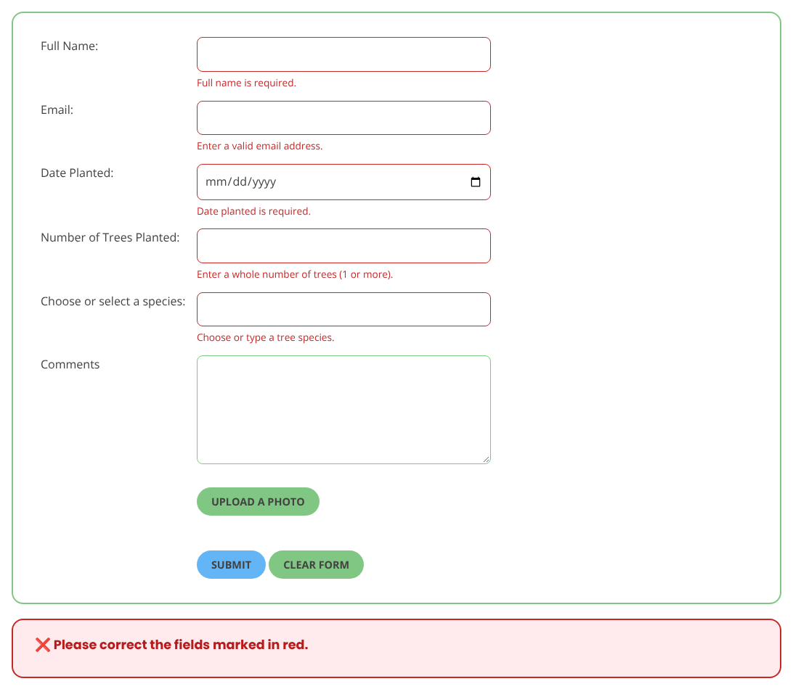
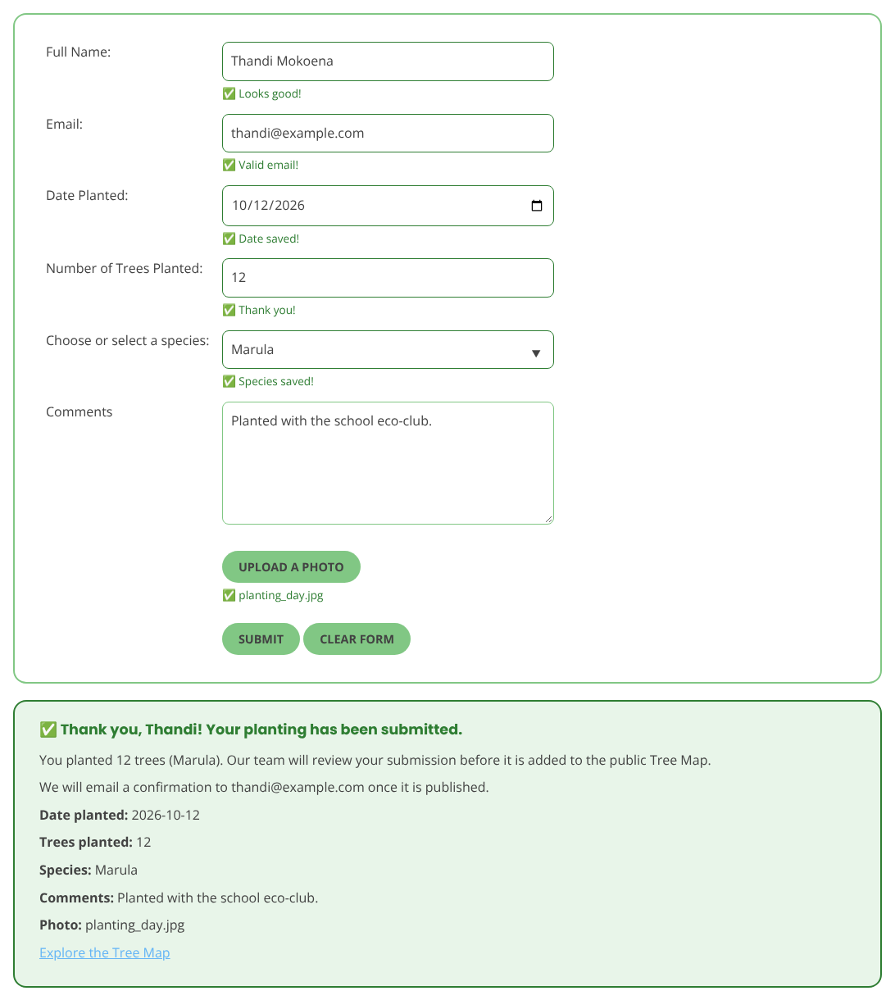

*Top: the errors shown for an empty form. Bottom: the confirmation after a correct submission.*

**Code snippet**
```js
// The tree must already be planted, so the date cannot be in the future
function checkDate() {
  const value = dateInput.value;
  if (!value) {
    showError(dateInput, dateError, 'Date planted is required.');
    return false;
  }
  if (value > todayString()) {
    showError(dateInput, dateError, 'The date cannot be in the future.');
    return false;
  }
  showOk(dateInput, dateError, '✅ Date saved!');
  return true;
}

function checkNumber() {
  const value = numberInput.value.trim();
  if (!/^\d+$/.test(value) || Number(value) < 1) {
    showError(numberInput, numberError, 'Enter a whole number of trees (1 or more).');
    return false;
  }
  showOk(numberInput, numberError, '✅ Thank you!');
  return true;
}
```

**Business purpose**
The Plant a Tree form is how the community adds to the planting records that Treeprint reports on (the annual goal and the Tree Map). Rules such as "no future dates" and "a whole number of trees" keep the records reliable, so the figures shown to donors and visitors can be trusted.

#### 3. Photo upload button and file check (`js/script.js`, Plant a Tree page)

**Screenshot**

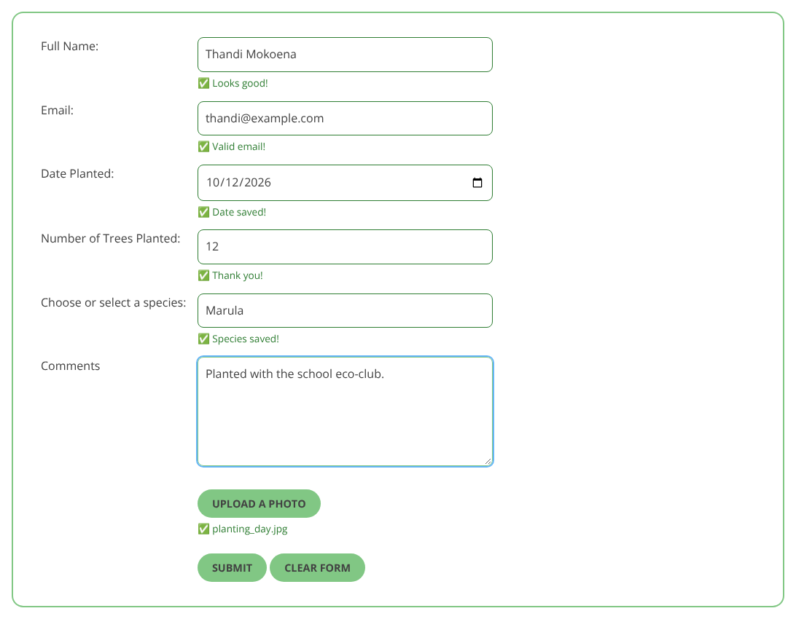

*After a photo is chosen, its file name is shown in green.*

**Code snippet**
```js
// The photo is optional but it must be an image
function checkPhoto() {
  if (photoInput.files.length === 0) { /* nothing chosen: no message */ return true; }
  const file = photoInput.files[0];
  if (file.type.indexOf('image/') !== 0) {
    photoError.textContent = 'Please choose an image file.';
    photoInput.value = '';
    return false;
  }
  photoError.textContent = '✅ ' + file.name;
  photoError.classList.add('ok');
  return true;
}

// The "Upload a photo" button opens the file chooser
uploadBtn.addEventListener('click', function() {
  photoInput.click();
});
photoInput.addEventListener('change', checkPhoto);
```

**Business purpose**
A photo is proof that a tree was planted and makes the Tree Map more trustworthy and appealing. A clear, styled upload button is easier to find than the browser's default control, and the image check stops wrong files from reaching the team that verifies each planting.

#### 4. Donation amount buttons and custom amount (`js/script.js`, Donate page)

**Screenshot**

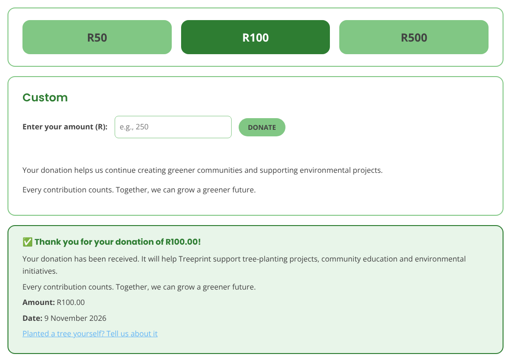
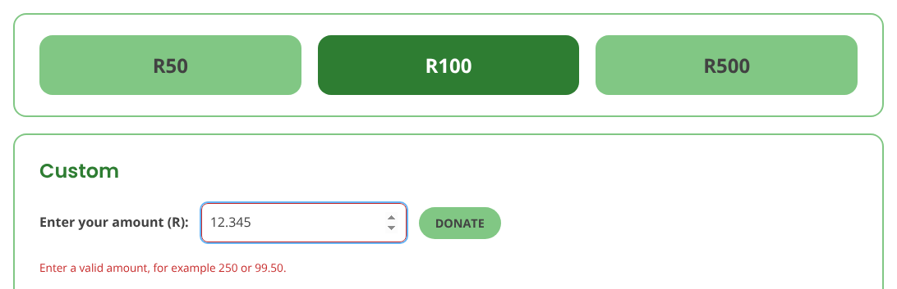
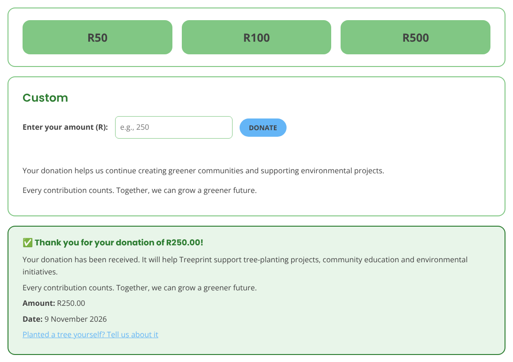

*Top: a fixed amount selected. Middle: an invalid custom amount. Bottom: a valid custom amount.*

**Code snippet**
```js
// R50, R100 and R500 buttons
amountButtons.forEach(function(button) {
  button.addEventListener('click', function() {
    amountButtons.forEach(function(other) { other.classList.remove('selected'); });
    button.classList.add('selected');
    clearField(customInput, amountError);
    customInput.value = '';
    thankDonor(Number(button.textContent.replace(/[^\d.]/g, '')));
  });
});

// Checks the custom amount: 1 or more, with at most 2 decimals
function checkAmount() {
  const value = customInput.value.trim();
  if (!/^\d+(\.\d{1,2})?$/.test(value)) {
    showError(customInput, amountError, 'Enter a valid amount, for example 250 or 99.50.');
    return false;
  }
  if (Number(value) < 1) {
    showError(customInput, amountError, 'The smallest donation is R1.');
    return false;
  }
  return true;
}
```

**Business purpose**
Donations fund the tree-planting projects. One-click amounts make giving fast, while the custom amount lets generous donors give what they choose. Immediate, friendly confirmation reassures the donor and links them on to the next action (planting a tree), which supports repeat involvement. Validation prevents typing mistakes such as `R-5` or `10.999`.

#### 5. Location search drop-down (`js/locations.js`, Tree Map page)

**Screenshot**

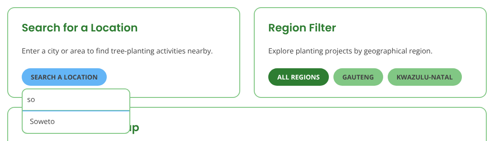
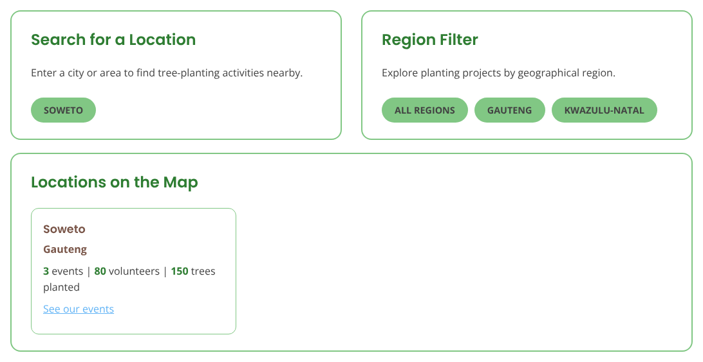

*Top: typing filters the list. Bottom: choosing a location shows only that location's card.*

**Code snippet**
```js
// Hides the locations in the list that do not match the typed letters
function filterLocations() {
  const text = locationInput.value.toUpperCase();
  locationLinks.forEach(function(link) {
    link.style.display = link.textContent.toUpperCase().indexOf(text) > -1 ? '' : 'none';
  });
}

// Shows only the cards that match. key is "region" or "location".
function showCards(key, value) {
  locationCards.forEach(function(card) {
    card.hidden = value !== 'all' && card.dataset[key] !== value;
  });
}

locationInput.addEventListener('input', filterLocations);
```

**Business purpose**
Visitors come to the Tree Map to find where trees are planted near them. Searching by typing is quicker than scrolling through every location and helps people find their own area, which makes the map more useful and encourages local participation.

#### 6. Region filter (`js/locations.js`, Tree Map page)

**Screenshot**

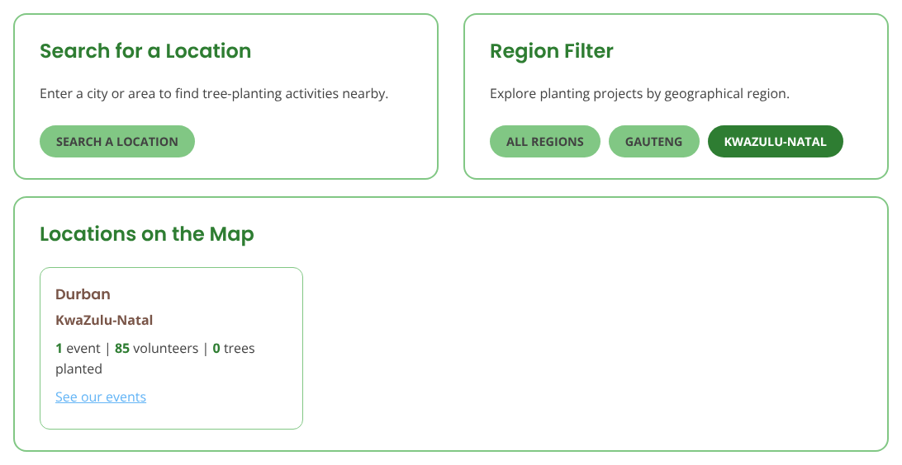

*Choosing a region shows only that region's locations and the active button turns dark green.*

**Code snippet**
```js
regionButtons.forEach(function(button) {
  button.addEventListener('click', function() {
    showCards('region', button.dataset.region);
    setActiveButton(button);
    locationBtn.textContent = 'Search a location';
  });
});

// Makes one region button dark green (the others go back to light green)
function setActiveButton(activeButton) {
  regionButtons.forEach(function(button) {
    button.classList.toggle('active', button === activeButton);
  });
}
```

**Business purpose**
Treeprint wants to show which regions have been planted and which still need trees. Filtering by region lets sponsors, volunteers and the team focus on one area at a time and compare regions quickly.

#### 7. Heat map of tree coverage (`js/heatmap.js`, Tree Map page)

**Screenshot**

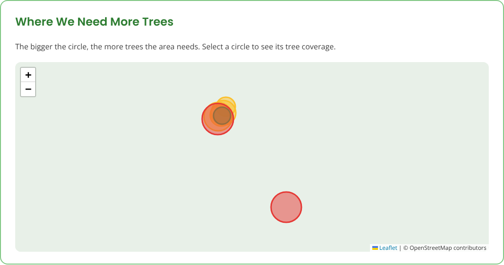
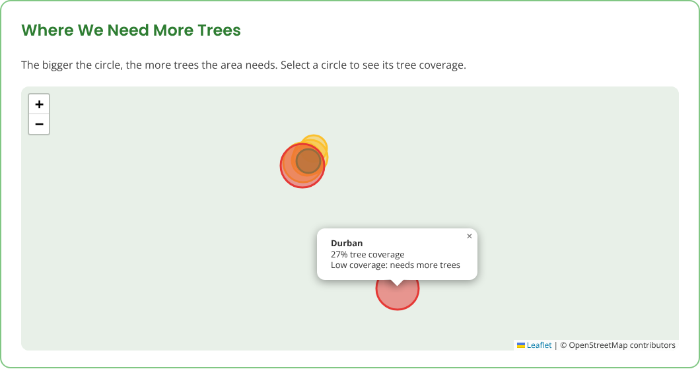
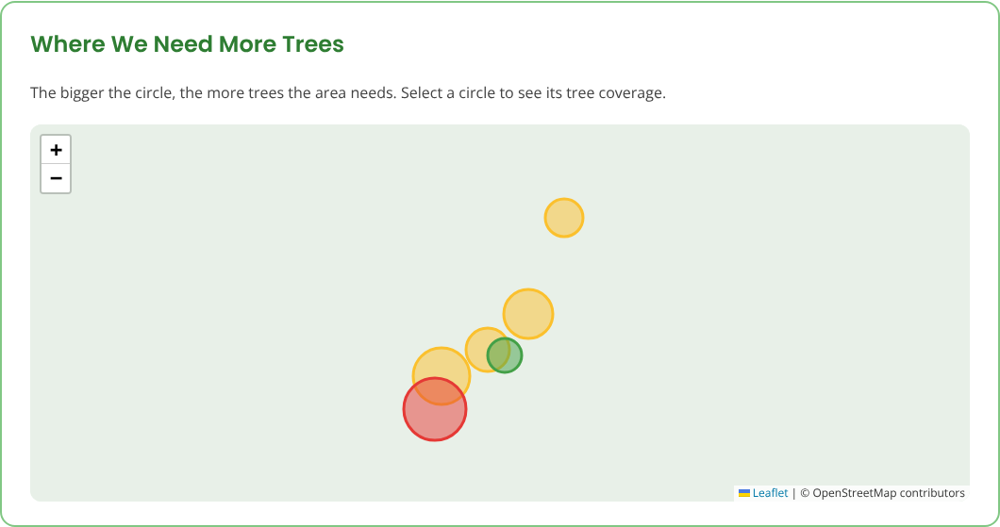

*Top: every location as a circle. Middle: selecting a circle opens a pop-up. Bottom: after choosing the Gauteng region the map zooms in on Gauteng.*

**Code snippet**
```js
function getColour(coverage) {
  if (coverage >= 70) return '#43A047';
  if (coverage >= 30) return '#FBC02D';
  return '#E53935';
}

// One circle for every card: the less coverage, the bigger the circle (size is in pixels)
locationCards.forEach(function(card) {
  const coverage = Number(card.dataset.coverage);
  const name = card.querySelector('h3').textContent;

  L.circleMarker([card.dataset.lat, card.dataset.lng], {
    radius: 10 + (100 - coverage) * 0.3,
    color: getColour(coverage),
    fillOpacity: 0.5
  }).addTo(map).bindPopup('<strong>' + name + '</strong><br>' + coverage + '% tree coverage<br>' + getStatus(coverage));
});
```

**Business purpose**
One of the main goals of Treeprint is to highlight the regions with little or no tree coverage. The heat map shows this at a glance, so volunteers know where to plant, donors see where their money is needed most, and the organisation can set priorities for its projects.

#### 8. Lightbox photo gallery (`js/lightbox3.min.js`, Events page)

**Screenshot**

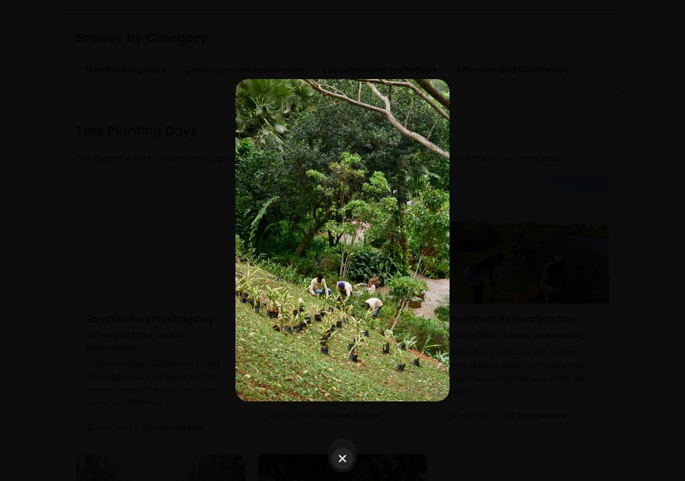

*Selecting an event photo opens it large on a dark background.*

**Code snippet**
```html
<!-- events.html: the library files -->
<link rel="stylesheet" href="../assets/styles/lightbox3.css">
<script defer src="../js/lightbox3.min.js"></script>

<!-- every photo is a link with data-lightbox -->
<a href="../assets/images/planting_day.jpg" data-lightbox>
  
</a>
```

**Business purpose**
The Events page is Treeprint's proof that volunteers make a difference. Letting visitors view the photos large without leaving the page keeps them engaged and builds trust, which supports volunteer sign-ups and donations.

### Responsive Design

Every page was tested at three widths. Each screenshot is the whole page and can be selected to open it full size.

#### Responsive explanation
- **Viewport:** every page has `<meta name="viewport" content="width=device-width, initial-scale=1.0">`, so phones show the page at its real width instead of a zoomed-out desktop page.
- **Flexible layout:** pages are built with flexbox and CSS grid. The main content has a maximum width, so it stays readable on large screens and fills the screen on small ones. Images use `max-width: 100%` and `height: auto` on phones.
- **Two breakpoints** (media queries in `assets/styles/style.css`):

| Screen | Breakpoint | What changes |
|--------|------------|--------------|
| Desktop | wider than 900px | Full layout: banner with text beside the image, cards side by side, four statistics in a row, four footer columns, three event cards per row, location cards in three columns |
| Tablet | 900px and below | Banner spacing is reduced, the home page cards stack, statistics and footer go to two columns, event cards and location cards go to two columns |
| Phone | 600px and below | Everything is one column: the navigation is stacked and centred, banner text is centred above the image, event cards show one per line, the About Us icons sit on top of their text, donation amounts stack, form labels sit above their inputs, headings are smaller and the map is shorter (300px) |

- **Images:** the banner images use `srcset` and `sizes` so that a smaller picture (`-250.jpg`) is loaded when the banner is small, and the full picture on high-resolution screens.
- **Checked:** at 1280px, 768px and 390px no page scrolls sideways, and the text, buttons, forms, map and footer stay readable.

### SEO Evidence

Every page has its own meta tags and Open Graph tags in the `<head>`. The screenshots below show the page source (right-click, *View page source*) of each page.

#### Meta tags displayed

Every page has a unique `<title>`, a unique `description`, `keywords`, a `robots` tag and a `canonical` link.

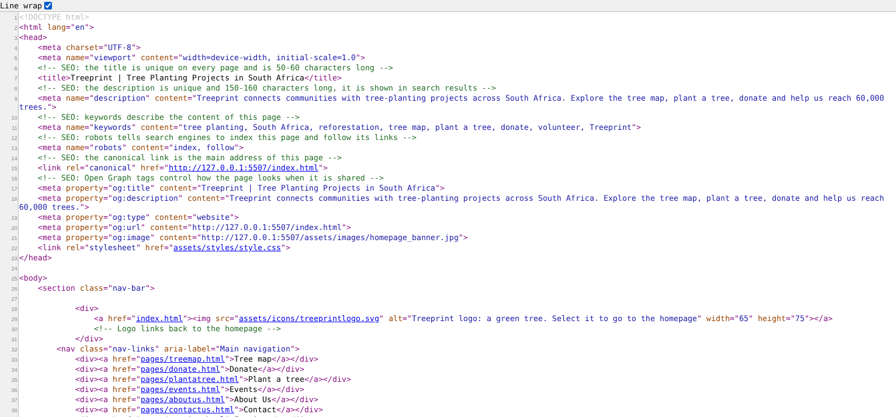

*Home page source (`index.html`): lines 7 to 15 are the title, description, keywords, robots and canonical tags.*

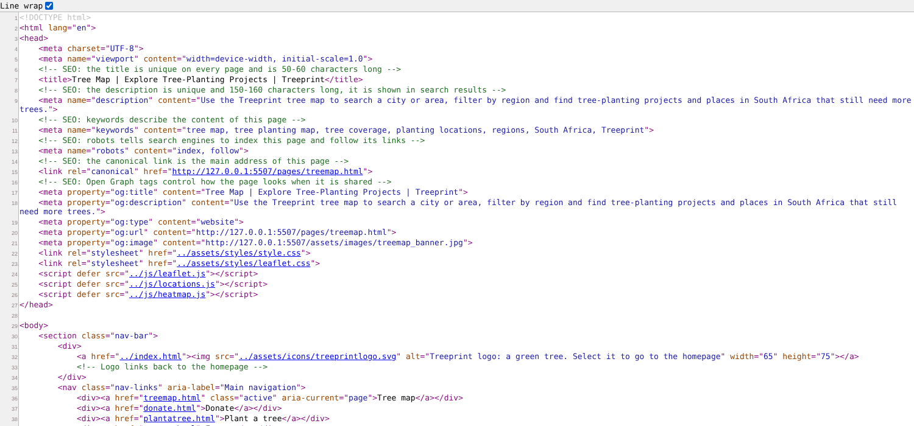

*Tree Map page source (`pages/treemap.html`).*

<details>
<summary>Page source of the other pages (Donate, Plant a Tree, Events, About Us, Contact Us, Enquiry)</summary>

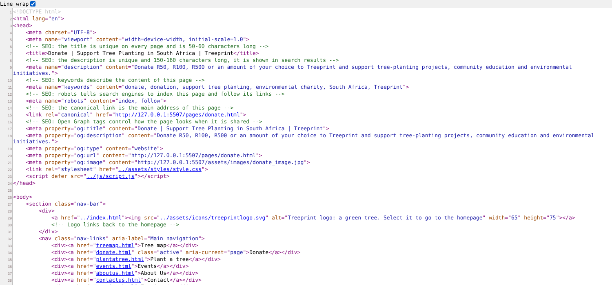

*Donate*

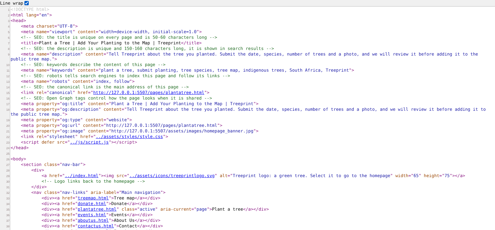

*Plant a Tree*

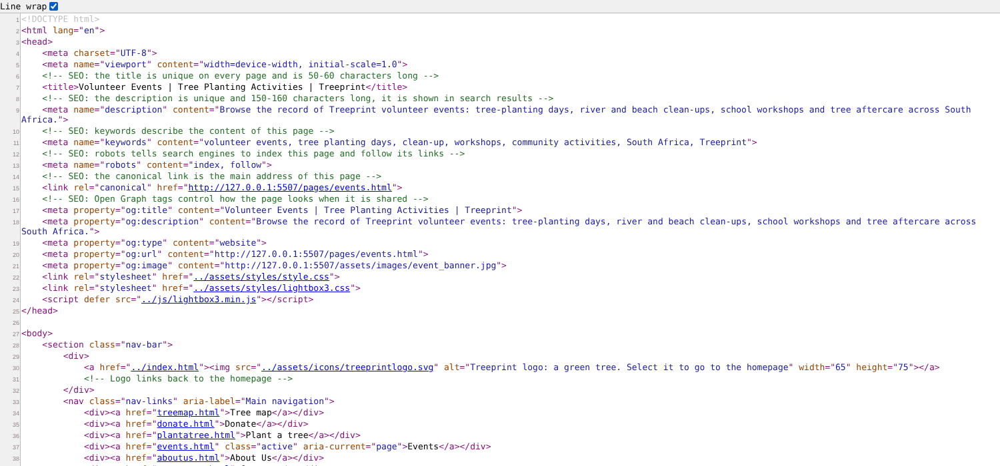

*Events*

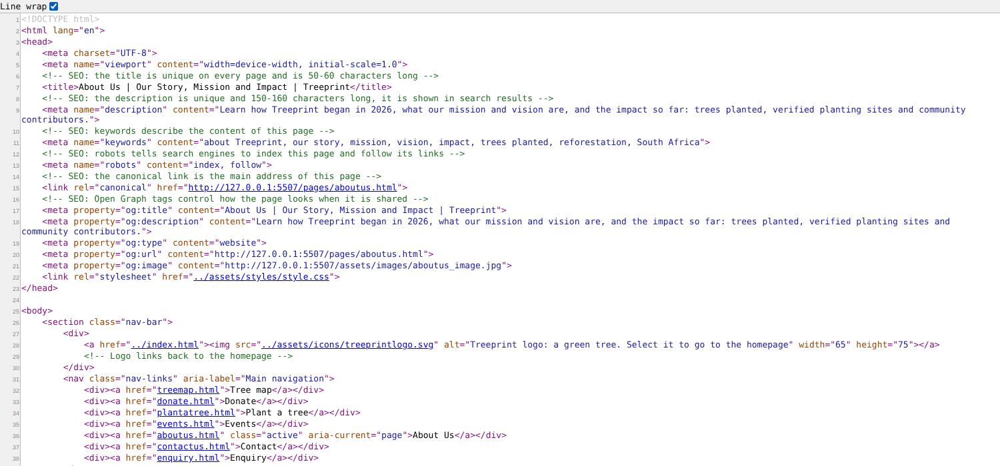

*About Us*

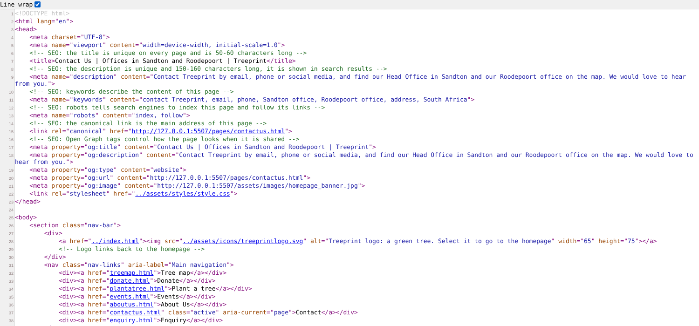

*Contact Us*

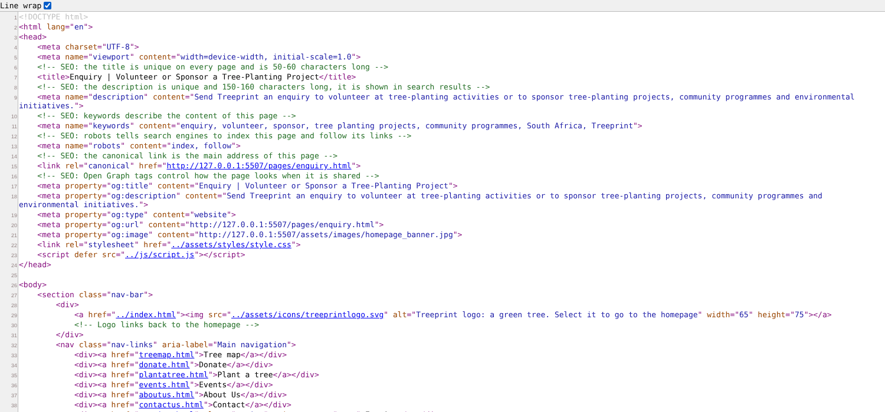

*Enquiry*

</details>

| Page | Title | Title length | Description length | Robots |
|------|-------|--------------|--------------------|--------|
| Home | Treeprint | Tree Planting Projects in South Africa | 50 | 154 | index, follow |
| Tree Map | Tree Map | Explore Tree-Planting Projects | Treeprint | 53 | 156 | index, follow |
| Donate | Donate | Support Tree Planting in South Africa | Treeprint | 58 | 150 | index, follow |
| Plant a Tree | Plant a Tree | Add Your Planting to the Map | Treeprint | 55 | 160 | index, follow |
| Events | Volunteer Events | Tree Planting Activities | Treeprint | 55 | 152 | index, follow |
| About Us | About Us | Our Story, Mission and Impact | Treeprint | 52 | 157 | index, follow |
| Contact Us | Contact Us | Offices in Sandton and Roodepoort | Treeprint | 58 | 156 | index, follow |
| Enquiry | Enquiry | Volunteer or Sponsor a Tree-Planting Project | 54 | 156 | index, follow |
| 404 | Page Not Found \| Treeprint Tree-Planting Platform | 49 | 140 | noindex, follow |

#### Open Graph evidence

Open Graph tags control how a page looks when its link is shared on social media or in a message (title, description, image and address). Every page has `og:title`, `og:description`, `og:type`, `og:url` and `og:image`.

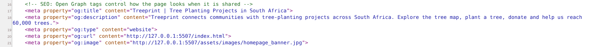

*The Open Graph tags of the Home page (lines 17 to 21 of `index.html`).*

| Page | `og:url` | `og:image` |
|------|----------|------------|
| Home | `/index.html` | `homepage_banner.jpg` |
| Tree Map | `/pages/treemap.html` | `treemap_banner.jpg` |
| Donate | `/pages/donate.html` | `donate_image.jpg` |
| Plant a Tree | `/pages/plantatree.html` | `homepage_banner.jpg` |
| Events | `/pages/events.html` | `event_banner.jpg` |
| About Us | `/pages/aboutus.html` | `aboutus_image.jpg` |
| Contact Us | `/pages/contactus.html` | `homepage_banner.jpg` |
| Enquiry | `/pages/enquiry.html` | `homepage_banner.jpg` |

The `og:title` and `og:description` are the same as the page's title and description, and `og:type` is `website` on every page.

#### Explanation
- **Title and description:** each page has its own title (about 50 to 60 characters) and its own description (about 150 to 160 characters), written with the words people search for, such as "tree planting", "tree map", "volunteer" and "South Africa". Search engines show these in the results.
- **Keywords:** a short list of keywords describes the content of each page.
- **Robots:** `index, follow` tells search engines to list the page and follow its links. The 404 page uses `noindex, follow`, so the error page never appears in search results.
- **Canonical link:** tells search engines the main address of each page so that it is not counted twice.
- **Open Graph:** gives a good title, description and picture when a link is shared. The `og:image` is a banner picture from `assets/images`.
- **Other SEO practices:** one `<h1>` per page, descriptive `alt` text on images, a language (`lang="en"`) on every page and clear, meaningful link text.
- **Before the website goes live:** the addresses in the canonical, `og:url`, `og:image` and sitemap use `http://127.0.0.1:5507` (the local test server). They must be changed to the real domain after hosting.

#### Sitemap

`sitemap.xml` lists every page of the website, with the date it was last changed and its importance (the home page is 1.0 and the other pages are 0.8). The 404 page is not included.

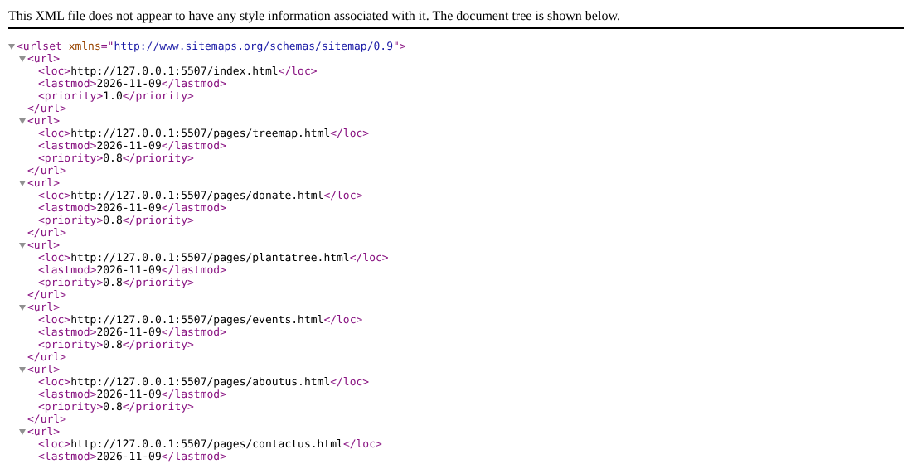

```xml
<urlset xmlns="http://www.sitemaps.org/schemas/sitemap/0.9">
  <url>
    <loc>http://127.0.0.1:5507/index.html</loc>
    <lastmod>2026-11-09</lastmod>
    <priority>1.0</priority>
  </url>
  <!-- treemap, donate, plantatree, events, aboutus, contactus and enquiry: priority 0.8 -->
</urlset>
```

#### Robots file

`robots.txt` tells search engine robots that the whole website may be visited, keeps them out of `/admin/` and `/tmp/`, and shows where the sitemap is.

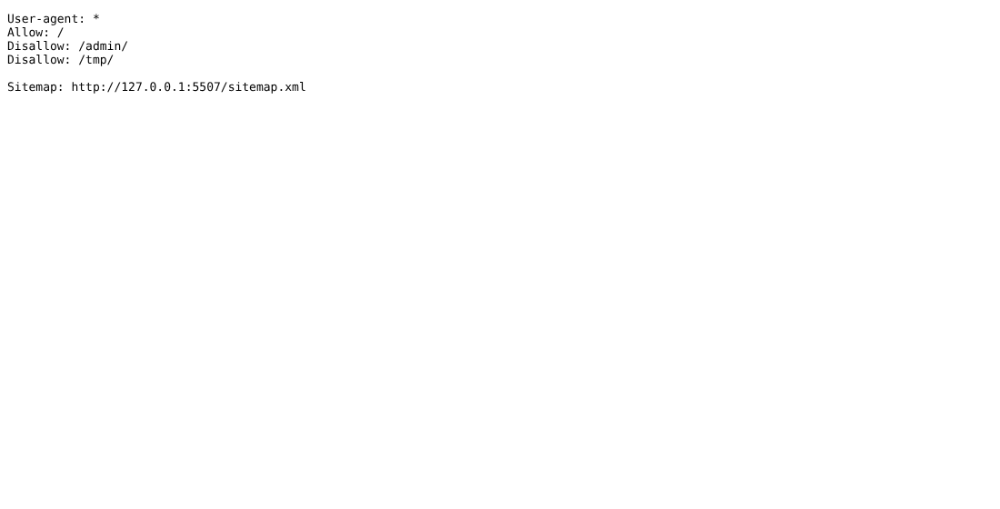

```text
User-agent: *
Allow: /
Disallow: /admin/
Disallow: /tmp/

Sitemap: http://127.0.0.1:5507/sitemap.xml
```

#### Custom 404 page

`404.html` is shown when a visitor opens an address that does not exist. It has a clear message and links back to the home page, the Tree Map and the Events page, and it is set to `noindex`.

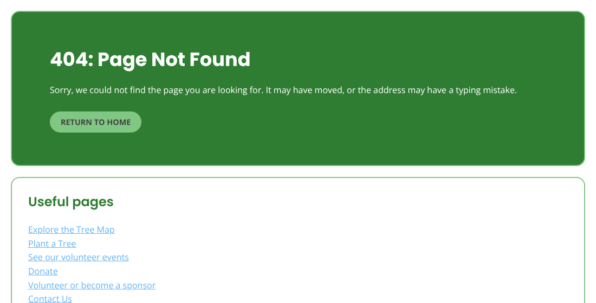

## Timeline and milestone

| Dates | Phase	| Key Activities | Milestone |
|-------|-------|----------------|-----------|
|20 July – 31 Aug|Project Initiation and Planning	Organisation overview|goals/KPIs, competitor analysis, feature list and technical requirements drafted and basic HTML structure|Website proposal submitted|
|1 Sept – 5 Oct|Visual Design & Styling	Colour palette, typography, apply visual styles|CSS styling and responsive breakpoints built and tested across devices|Visual design (CSS styling & responsive design) complete|
|6 – 31 Oct|Enhancing Functionality, SEO & Deployment|Location-based feature, SEO, JavaScript interactivity, forms and deployment|Complete website delivered|

## Site map
index.html  
│  
├── aboutus.html          
├── contactus.html           
├── donate.html          
├── enquiry.html  
├── plantatree.html   
└── treemap.html

### Site map (Part 3 update)
The Events page, the error page and the supporting files were added in Part 3:

```
index.html
│
├── pages/aboutus.html
├── pages/contactus.html
├── pages/donate.html
├── pages/enquiry.html
├── pages/events.html          (new in Part 3)
├── pages/plantatree.html
├── pages/treemap.html
│
├── 404.html                   (new in Part 3)
├── robots.txt                 (new in Part 3)
├── sitemap.xml                (new in Part 3)
│
├── js/                        script.js, locations.js, heatmap.js, leaflet.js, lightbox3.min.js
└── assets/                    fonts, icons, images, styles
```

## Screenshot
### Desktop


### Tablet


### Phone


## Changelog
### Part 1
Tracking changes and improvements to the website over time with the same order all tasks have been completed.
- Initial project setup: project’s folder created with basic organisation.
- The banner for the Homepage downloaded and saved
- Fonts styles downloaded and added to the folder.
- All text relevant to the website completed and added to the folder.
- Html completed in a day and pushed to GitHub.
- The remaining of the images and icons downloaded and saved.
- Few fixes in the Html.
- Few fixes to the chosen proposal.
- Complete the READme

### Part 2
30 September 2026
- Part 2: continued development (commit aa4512a).
- Update README.md (commit 737e301).
- Update README for improved structure and clarity (commit 3cb893d).
- Revise site map in README.md (commit 5a91f6a).
- Fix formatting of enquiry.html in README (commit dcd7b9e).
4 October 2026
- Home page css (commit b3d8c89).
- Update README.md (commit e0e26c2).
- Home page added css (commit 04748d3).
- Merge remote changes (commit ffe02dc).
- Treemap and plantatree css added (commit 27fd54d).
5 October 2026
- CSS and small fixes added (commit efaa264).
- Footer and small fixes (commit 520639b).


### Part 3
7 November 2026
- Small fixes to the enquiry page (commit 8da5e4e).

8 November 2026
- CSS improved (commit 751e21c).
- Responsive web design improved (commit fa03bec).
- About Us banner added (commit e1825ab).

9 November 2026
- JavaScript added (commit 2d6e1a4).
- Events page added (commit 4307a98).
- Lightbox added (commit e668ad1).
- SEO added (commit e347331).
- Heat map added (commit ca6b8c3).
- Finalisation (commit 4a940f9).
- Supporting files added: 404 page, robots.txt and sitemap.xml (commit d2f49b1).
- Layout enhanced (commit c3c0655).
- README updated for Part 3: JavaScript features, responsive design, SEO evidence and the Part 2 feedback.

## References

- Domains, 2026. Beginner’s Guide to Website Hosting. [online] Available at: < https://www.domains.co.za/knowledgebase/hosting/website-hosting/?keyword=hosting%20for%20website&matchtype=p&device=c&devicemodel&creative=386487473464&network=g&campaignid=174153030&adgroupid=26325629550&gad_source=1&gad_campaignid=174153030&gbraid=0AAAAAD7prVJf7vm_Ed-X9zmH0lXRLrqb0&gclid=EAIaIQobChMI0461ir-nlgMV1oFQBh11txlSEAAYASAAEgJu4vD_BwE> [Accessed 17 August 2026].
- Ecomatcher, 2026. Get Started with EcoMatcher. [online] Available at: <https://www.ecomatcher.com/get-started/> [Accessed 3 August 2026].
- Google. 2026. Gemini (Version 3). [Large language model]. Available at: <https://gemini.google.com/app> [Accessed: 5 August 2026.]
- Hostafrica, 2026. How Much Does It Cost to Build a Website in South Africa? [online] Available at: <https://hostafrica.co.za/blog/websites/website-basics/how-much-does-a-website-cost-in-south-africa/> [Accessed 15 August 2026].


### Part 3 references

- Google Fonts, 2026. *Open Sans*. [online] Available at: <https://fonts.google.com/specimen/Open+Sans> [Accessed 9 November 2026].
- Google Fonts, 2026. *Poppins*. [online] Available at: <https://fonts.google.com/specimen/Poppins> [Accessed 9 November 2026].
- Leaflet, 2026. *API reference*. [online] Available at: <https://leafletjs.com/reference.html> [Accessed 9 November 2026].
- Leaflet, 2026. *Quick Start Guide*. [online] Available at: <https://leafletjs.com/examples/quick-start/> [Accessed 9 November 2026].
- Lokesh Dhakar, 2026. *Lightbox3*. [online] Available at: <https://lokeshdhakar.com/projects/lightbox3/> [Accessed 9 November 2026].
- MDN Web Docs, 2026. *Responsive images*. [online] Available at: <https://developer.mozilla.org/en-US/docs/Web/HTML/Guides/Responsive_images> [Accessed 9 November 2026].
- Open Graph Protocol, 2026. *The Open Graph protocol*. [online] Available at: <https://ogp.me/> [Accessed 9 November 2026].
- OpenStreetMap, 2026. *Copyright and License*. [online] Available at: <https://www.openstreetmap.org/copyright> [Accessed 9 November 2026].
- OpenStreetMap Foundation, 2026. *Tile Usage Policy*. [online] Available at: <https://operations.osmfoundation.org/policies/tiles/> [Accessed 9 November 2026].
- Pexels, 2026. *Free Coastal Clean Up Photos*. [electronic print] Available at: <https://www.pexels.com/photo/person-cleaning-beach-shore-with-plastic-bag-36713501/> [Accessed 5 November 2026].
- Pexels, 2026. *Free Composting Workshop Photos*. [electronic print] Available at: <https://www.pexels.com/photo/vegetables-on-the-soil-5503338/> [Accessed 5 November 2026].
- Pexels, 2026. *Free Mapping Training Photos*. [electronic print] Available at: <https://www.pexels.com/photo/black-magnifying-glass-on-a-map-6033812/> [Accessed 5 November 2026].
- Pexels, 2026. *Free Mulching And Tree Guards Photos*. [electronic print] Available at: <https://www.pexels.com/photo/man-in-blue-long-sleeve-shirt-planting-a-tree-11534117/> [Accessed 5 November 2026].
- Pexels, 2026. *Free Nursery Potting Photos*. [electronic print] Available at: <https://www.pexels.com/photo/man-doing-gardening-inside-glasshosue-6508571/> [Accessed 5 November 2026].
- Pexels, 2026. *Free School Talks About Trees Photos*. [electronic print] Available at: <https://www.pexels.com/photo/girl-hiding-behind-a-tree-10044929/> [Accessed 5 November 2026].
- Pexels, 2026. *Free Summer Watering Round Photos*. [electronic print] Available at: <https://www.pexels.com/photo/watering-plants-with-garden-hose-16229115/> [Accessed 5 November 2026].
- Pexels, 2026. *Free Tree Health Survey Photos*. [electronic print] Available at: <https://www.pexels.com/photo/person-using-a-tape-measure-on-a-tree-trunk-6636343/> [Accessed 5 November 2026].
- Pexels, 2026. *Free Trees Next To River Photos*. [electronic print] Available at: <https://www.pexels.com/photo/lush-greenery-by-a-tranquil-river-scene-39595599/> [Accessed 5 November 2026].
- Pexels, 2026. *Free Volunteer Appreciation Day Photos*. [electronic print] Available at: <https://www.pexels.com/photo/two-people-in-blue-shirts-holding-green-potted-plants-8543104/> [Accessed 5 November 2026].
- Unsplash, 2026. *Alien Plant Removal*. [electronic print] Available at: <https://unsplash.com/photos/a-close-up-of-a-plant-with-many-leaves-7SeRQRY_g0k> [Accessed 5 November 2026].
- Unsplash, 2026. *Indigenous seed workshop*. [electronic print] Available at: <https://unsplash.com/photos/person-holding-brown-and-black-plant-aP6WE14v_ow> [Accessed 5 November 2026].
- Unsplash, 2026. *Orchard planting*. [electronic print] Available at: <https://unsplash.com/photos/green-grass-field-with-white-wooden-fence-Mcwg75fwYkM> [Accessed 5 November 2026].
- Unsplash, 2026. *Park Litter Pick*. [electronic print] Available at: <https://unsplash.com/photos/volunteers-cleaning-up-litter-in-a-forest-setting-SL4NGT-XP1I> [Accessed 5 November 2026].
- Unsplash, 2026. *Planting Park*. [electronic print] Available at: <https://unsplash.com/photos/gardeners-planting-rows-of-small-plants-on-a-hillside-zvEqjbA42mE> [Accessed 5 November 2026].
- Unsplash, 2026. *Recycling drop-off day*. [electronic print] Available at: <https://unsplash.com/photos/photo-of-four-assorted-color-compost-pits-near-empty-road-v3lA7GROOHg> [Accessed 5 November 2026].
- Unsplash, 2026. *Riverside clean-up*. [electronic print] Available at: <https://unsplash.com/photos/volunteers-collecting-trash-on-a-beach-with-blue-bags-WwWPcQkzHPk> [Accessed 5 November 2026].
- Unsplash, 2026. *Roadside greening*. [electronic print] Available at: <https://unsplash.com/photos/asphalt-road-lined-with-green-trees-65DN4pNyQpw> [Accessed 5 November 2026].
- Unsplash, 2026. *School greening*. [electronic print] Available at: <https://unsplash.com/photos/student-examining-flowers-in-garden-V-Naw9348T8> [Accessed 5 November 2026].
- Unsplash, 2026. *Trees*. [electronic print] Available at: <https://unsplash.com/photos/green-pine-tree-during-daytime-3BlVILvh9hM> [Accessed 20 September 2026].
- Unsplash, 2026. *Trees*. [electronic print] Available at: <https://unsplash.com/photos/pine-trees-nTRDnDdDYk8> [Accessed 20 September 2026].
- Unsplash, 2026. *Trees*. [electronic print] Available at: <https://unsplash.com/photos/a-group-poses-for-a-photo-outdoors-RP1uj-umiKk> [Accessed 5 November 2026].
- Unsplash, 2026. *Trees*. [electronic print] Available at: <https://unsplash.com/photos/a-group-of-people-standing-next-to-a-river-CxL29J-aM5E> [Accessed 5 November 2026].
- Unsplash, 2026. *Tree walk*. [electronic print] Available at: <https://unsplash.com/photos/man-in-white-t-shirt-walking-on-sidewalk-during-daytime-3XzLA1kSuzE> [Accessed 5 November 2026].
- W3Schools, 2026. *CSS object-fit Property*. [online] Available at: <https://www.w3schools.com/css/css3_object-fit.asp> [Accessed 9 November 2026].
- W3Schools, 2026. *How TO - Filter Elements*. [online] Available at: <https://www.w3schools.com/howto/howto_js_filter_elements.asp> [Accessed 9 November 2026].
- W3Schools, 2026. *How TO - Search/Filter Dropdown*. [online] Available at: <https://www.w3schools.com/howto/howto_js_filter_dropdown.asp> [Accessed 9 November 2026].
- W3Schools, 2026. *HTML datalist Tag*. [online] Available at: <https://www.w3schools.com/tags/tag_datalist.asp> [Accessed 9 November 2026].
- W3Schools, 2026. *HTML input accept Attribute*. [online] Available at: <https://www.w3schools.com/tags/att_input_accept.asp> [Accessed 9 November 2026].
- W3Schools, 2026. *JavaScript Form Validation*. [online] Available at: <https://www.w3schools.com/js/js_validation.asp> [Accessed 9 November 2026].
- W3Schools, 2026. *JavaScript HTML DOM EventListener*. [online] Available at: <https://www.w3schools.com/js/js_htmldom_eventlistener.asp> [Accessed 9 November 2026].
- W3Schools, 2026. *JavaScript Regular Expressions*. [online] Available at: <https://www.w3schools.com/js/js_regexp.asp> [Accessed 9 November 2026].

## Disclosure of AI Usage in My Assessment

In the development of this project, I have used generative AI tools to assist in various parts of the assignment. Below is a detailed disclosure of where and how these tools were used:

### 1. **Section(s) in which Generative AI was used:**
- **Debugging**: Used AI to find and fix the layout of my page.

### 2. **Name of AI Tool(s) Used:**
- **Claude** (Anthropic)

### 3. **Purpose/Intention Behind Use:**
- **Meaning Making**: Understanding layout issue.

### 4. **Date(s) in Which Generative AI Was Used:**
- **5 October 2026**

### 5. **Link to the AI Chat(s) or Screenshots:**
- **Chat 1 (Website development)**: [Screenshot of the AI conversation/chat]


- **Chat 2 (Website development)**: [Screenshot of the AI conversation/chat]


### Part 3 update: use of generative AI

### 1. **Section(s) in which Generative AI was used (Part 3):**
- **Heat map**: Used AI to write the heat map of tree coverage on the Tree Map page.
- **Debugging**: Used AI to find and fix mistakes in the pages (active link in the navigation bar, upload button, forms, lightbox links, file paths and the phone layout of the Events and About Us pages).

### 2. **Name of AI Tool(s) Used:**
- **Claude** (Anthropic)

### 3. **Purpose/Intention Behind Use:**
- **Meaning Making**: Understanding how the heat map work.

### 4. **Date(s) in Which Generative AI Was Used:**
- **November 2026** (up to 9 November 2026)

### 5. **Link to the AI Chat(s) or Screenshots:**
- **Chat 3 (Website development, Part 3)**: 


---
